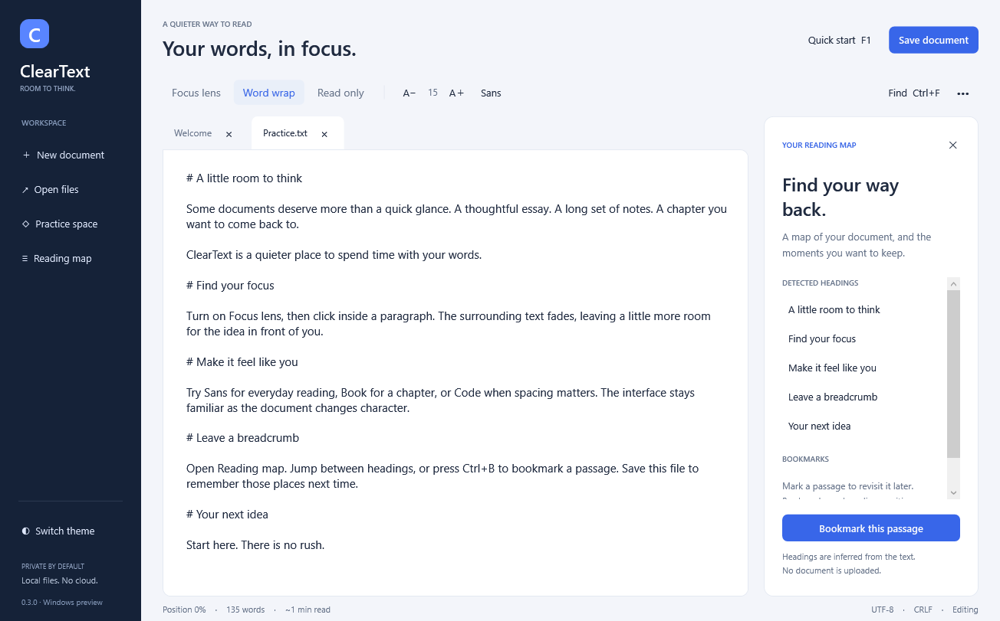
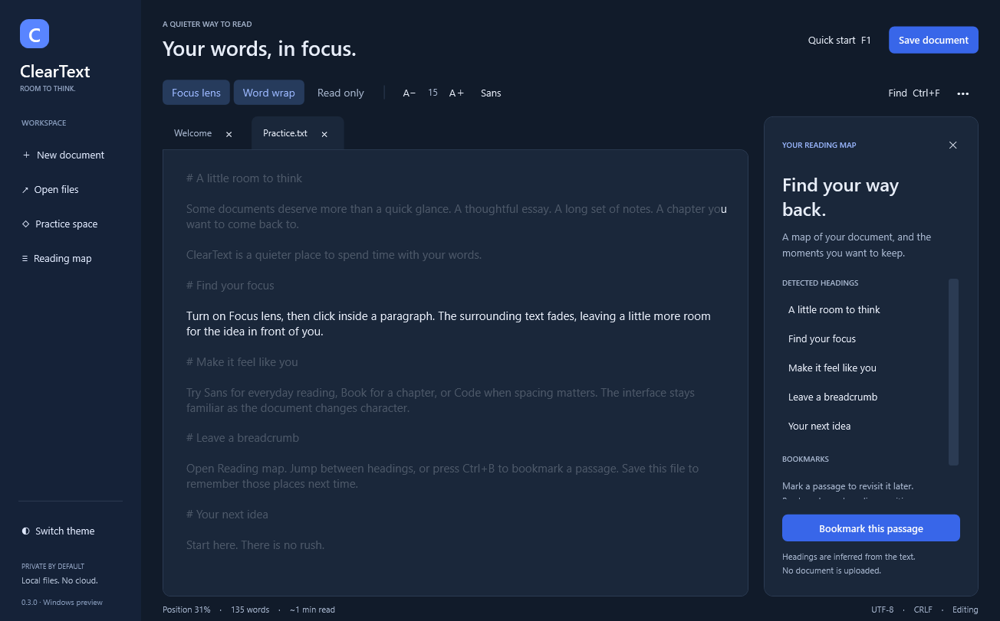

# ClearText

**A reading desk for plain-text files: find your focus, leave a bookmark, return where you stopped.**

Native C# / WPF · Windows x64 · Preview 0.3.0 · MIT



## Download

Get the Windows x64 ZIP from [Releases](https://github.com/Anaghh/ClearText/releases).
Extract it and run **ClearText.exe**. The app uses Windows .NET Framework 4.8;
it does not require Python, a browser, or a separate web runtime. The executable
is unsigned. Verify the release SHA-256 before deciding whether to run it.

## What makes this a reading desk

**Focus Lens** fades the paragraphs around your cursor. Click another passage
and the spotlight follows. The text remains editable and selectable.

**Reading map** infers an outline from Markdown headings, chapter titles, and
short ALL CAPS lines. Jump between sections, or press **Ctrl+B** to bookmark a
passage. It is a navigation aid, not a complete Markdown parser.

**A place to return to** remembers your cursor position and bookmarks for saved,
unchanged files. It also remembers your theme, font, text size, and Focus Lens
preference. Existing reading marks are ignored when a file's bytes have changed.

**Typography with a purpose:** Sans (Segoe UI) for everyday text, Book (Georgia)
for sustained reading, and Code (Consolas) for fixed-width content. Interface
text stays in Segoe UI. Estimated reading time uses a simple 220-words/minute
assumption; position percentage tracks the cursor, not measured reading progress.



## The essentials

- A modern document canvas, styled tabs, and a compact navigation rail.
- Light and dark themes, font sizing, word wrap, and line numbers with wrap off.
- Per-document read-only mode, inline search, and go to line.
- A collapsible six-step tutorial with a safe practice document.
- UTF-8 / UTF-16 detection, preserving BOM and UTF-16 byte order.
- Native Windows open/save dialogs and save / save-as shortcuts.
- Save prompts, temporary-file replacement, and external-change checks before saving.
- Background file reads, with a 20 MB admission limit.
- Local operation with no accounts, telemetry, or cloud synchronization.

Read [the five-minute tutorial](TUTORIAL.md). Press **F1** for in-app guidance.

## Shortcuts

| Shortcut | Action |
| --- | --- |
| Ctrl+N | New document |
| Ctrl+O | Open files |
| Ctrl+S | Save |
| Ctrl+Shift+S | Save as |
| Ctrl+F | Find; Enter advances while search input is focused |
| Ctrl+G | Go to logical line |
| Ctrl+W | Close document |
| Ctrl+B | Toggle bookmark at the current position |
| F1 | Toggle tutorial |
| Escape | Close search |

Undo, redo, cut, copy, paste, and select-all use standard Windows text controls.

## Build on Windows

Run PowerShell in the source directory:

```powershell
.\build_windows.ps1
```

The script uses the Windows .NET Framework x64 C# compiler and WPF assemblies,
runs native regression tests, and packages the EXE, source, tutorial, license,
and checksums under `release/`. No third-party build packages are required.
A graphical Windows session is required for the desktop tests.

Sources are in `native/`: `MainWindow.xaml` defines the interface, `ClearText.cs`
implements behavior, and `NativeTests.cs` contains the regression checks.

A successful push to `main` builds a GitHub Actions artifact and publishes a
preview release for `Workspace.Version` if that version does not already exist.
For a new release, increment the version in C# assembly metadata, the workspace
constant, the XAML version label, and app.manifest. Existing releases are not overwritten.

## Preview limitations

Designed for Windows 10/11 x64 with .NET Framework 4.8. Local testing was on
Windows 11; broader Windows-version and accessibility testing remains pending.
Files over 20 MB are declined. Reading happens in the background, but displaying
large files, search, and saving can still pause the interface. This is not a
streaming large-file viewer.

No crash recovery or automatic reopening of previous tabs yet. Reading positions
are restored when you manually reopen an unchanged saved file.
Mixed newlines are normalized to the detected style when saving. External file
checks run before replacement; another application could still change a file
between that check and the save. Avoid simultaneous editing in multiple apps.

## Local preferences and privacy

The app stores preferences, full file paths, file hashes, cursor positions, and
bookmark offsets for up to 100 saved files in
`%LOCALAPPDATA%/ClearText/preferences.xml`. It does not store document contents
there. Unsaved documents are not persisted. Deleting that file while the app is
closed resets the remembered data. There is no network code or telemetry.

## Contribute and license

Read [CONTRIBUTING.md](CONTRIBUTING.md), [design research](DESIGN_RESEARCH.md),
and [third-party notices](THIRD_PARTY_NOTICES.md). Source is [MIT licensed](LICENSE).
